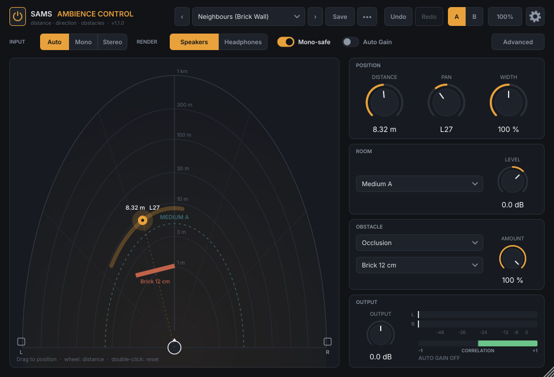
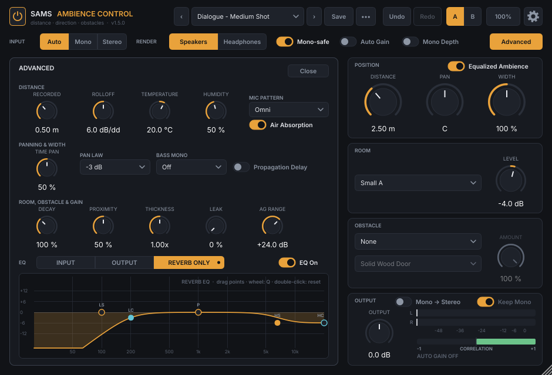

# SAMS AMBIENCE CONTROL — odległość, kierunek i przeszkody dla miksu filmowego

**SAMS AMBIENCE CONTROL** to wtyczka VST3 (oraz AU i Standalone) do umieszczania dźwięku w przestrzeni na podstawie psychoakustyki i akustyki fizycznej. Pozwala:

- oddalać lub przybliżać źródło,
- panoramować je lewo–prawo z różnicami **czasu i fazy**, a nie tylko głośności,
- zawężać i poszerzać obraz stereo,
- postawić **przeszkodę** między źródłem a mikrofonem: ścianę, drzwi, szybę, zasłonę, róg budynku.

Przeznaczenie: postprodukcja dźwięku w filmie — dopasowanie perspektywy dialogu do planu, źródła poza kadrem, dźwięki zza ściany, drzwi lub okna, przejazdy.



## ⬇️ Pobierz

Gotowe instalatory są w zakładce **[Releases](../../releases/latest)**:

- **Windows:** `SAMS-Ambience-Control-x.y.z-Windows-Setup.exe`
- **macOS:** `SAMS-Ambience-Control-x.y.z-macOS.pkg`

Strona wydania zawiera instrukcję instalacji krok po kroku.

- Specyfikacja projektu: [`PROMPT.md`](PROMPT.md)
- Modele, wzory, parametry i wyniki testów: [`docs/DESIGN.md`](docs/DESIGN.md)

## Najważniejsze cechy
- **Odległość:** prawo odwrotnych kwadratów liczone względem odległości nagrania, pochłanianie powietrza wg ISO 9613-1, stosunek dźwięku bezpośredniego do pogłosu, wczesne odbicia i pogłos zależne od pozycji, kompensacja efektu zbliżeniowego. Doppler i opóźnienie propagacji są opcjonalne.
- **Panorama:** w trybie *Speakers* hybryda poziom + czas z trybem **Mono-safe**. W trybie *Headphones* działa binauralny model sferycznej głowy (ITD Woodwortha, cień głowy Browna–Dudy, pole bliskie) — także dla odbić, a ogon pogłosu ma naturalną spójność basu między uszami.
- **Mono / Stereo / Surround:** przełącznik *Input* (Auto / Mono / Stereo). Obsługiwane układy: 1→1, 1→2, 2→2 oraz wyjścia **5.0, 5.1, 7.0, 7.1, 5.1.2, 5.1.4, 7.1.2, 7.1.4** (z mono, stereo albo z tego samego układu, np. na szynie surround). W surround dialog w centrum trafia do kanału C, panorama działa po L–C–R, odbicia od ścian bocznych i tylnej idą do surroundów, odbicie od sufitu do kanałów wysokościowych, a pogłos jest osobno zdekorelowany w każdym kanale (LFE cichy, przy wejściu surround LFE przechodzi bez zmian).
- **Szerokość** 0–200 % zgodna z mono: suma L+R nie zmienia się przy poszerzaniu. Do tego *Bass Mono*.
- **Przeszkody:**
  - *Obstruction* — dyfrakcja wg Maekawy;
  - *Occlusion* — przenikanie przez przegrodę: prawo masy, koincydencja, rezonans przegrody podwójnej, szczeliny. Dostępne materiały: zasłona, szyba, drzwi płytowe, drzwi pełne, ściana G-K, cegła, beton, karoseria.
- **Auto Gain** (domyślnie **wyłączony**): utrzymuje głośność (ważenie K wg BS.1770), żeby zmieniała się tylko barwa i przestrzeń. Wartość wynika z modelu, a nie z pomiaru sygnału, więc nie pompuje.
- **Wymagania filmowe:**
  - zero latencji,
  - brak przesunięcia względem obrazu (opóźnienie propagacji domyślnie OFF),
  - płynna automatyka,
  - deterministyczny render, niezależny od bufora,
  - stałe ID parametrów i wersjonowany stan.
- **Mono Depth:** tryb dla mono dialogu z planu. Wyjście jest ściśle mono (L = R), a działają tylko wskazówki głębi: odległość, powietrze, pomieszczenie (prawdziwy pogłos mono zamiast składania stereo) i przeszkoda. Bez panoramy, szerokości i różnic czasu.
- **Mono → Stereo + Keep Mono:** zamienia sygnał mono na naturalne stereo (przełączniki w karcie *Output*). Z **Keep Mono** (domyślnie włączone) głos zostaje mono w środku, a stereo staje się tylko przestrzeń zapisana w nagraniu — pogłos po każdym słowie i szum tła pomieszczenia (bez latencji). Bez Keep Mono poszerzany jest cały sygnał. Działa, gdy insert wtyczki jest stereo: w wariancie mono → stereo (1 wejście, 2 wyjścia), przy *Input = Mono* oraz na ścieżkach i grupach stereo, na których leży nagranie mono — także gdy jest tylko w jednym kanale (np. kanał 1 rekordera lub kamery), jest spanoramowane albo minimalnie różni się w kanałach; takie nagranie jest najpierw wyśrodkowane bez zmiany głośności. Jest w pełni zgodne z mono: suma L+R to oryginalny dźwięk, oba kanały mają tę samą barwę i poziom, a bas zostaje w środku. Siłę efektu ustawia *Width*. Prawdziwe stereo przechodzi bez zmian.
- **Equalized Ambience** (domyślnie **włączone**): automatyczny EQ wyliczany z odległości i położenia — pochłanianie powietrza, usuwanie basu z efektu zbliżeniowego mikrofonu i delikatne przyciemnienie góry po stronie oddalonej od źródła. Po wyłączeniu zmienia się tylko poziom, czas i pomieszczenie, a barwa zostaje jak w nagraniu.
- **EQ (panel Advanced):** trzy niezależne korektory w zakładkach — **Input** (sygnał wejściowy, zanim trafi do pomieszczenia), **Output** (całe wyjście) i **Reverb only** (tylko pogłos; dźwięk bezpośredni bez zmian). Każdy ma Low Cut i High Cut 12 dB/okt, półkę niską, filtr szczytowy i półkę wysoką, interaktywny wykres z przeciąganymi punktami i włącznik *EQ On* (A/B bez trzasków). Wszystko automatyzowalne.
- **ON/OFF:** przycisk zasilania w lewym górnym rogu (bypass bez trzasków — sygnał przechodzi bez zmian, interfejs przygasa).
- **Sprawdzanie aktualizacji:** ikona koła zębatego → *Check for updates…* porównuje wersję z najnowszym wydaniem na GitHubie i proponuje przejście do strony pobierania.
- **UI:** ciemne i minimalistyczne, ze skalowaniem 50–200 % i widokiem sceny z góry, po którym przeciąga się źródło. Dodatkowo: 26 presetów filmowych, presety użytkownika, porównanie A/B, cofnij/ponów (Undo/Redo).

## Budowanie

Wymagania: CMake ≥ 3.22 i kompilator C++20 (MSVC 2022, Xcode 14+, GCC 11+ lub Clang 14+). JUCE 8.0.9 pobiera się automatycznie.

```bash
cmake -S . -B build -DCMAKE_BUILD_TYPE=Release
cmake --build build --config Release --target Ambience_VST3
# macOS: dodatkowo Ambience_AU; Universal Binary: -DCMAKE_OSX_ARCHITECTURES="arm64;x86_64"
# istniejący JUCE: -DFETCHCONTENT_SOURCE_DIR_JUCE=/ścieżka/do/JUCE
```

Linux (Ubuntu) — potrzebne pakiety: `libasound2-dev libx11-dev libxrandr-dev libxinerama-dev libxcursor-dev libxext-dev libxcomposite-dev libfreetype-dev libfontconfig1-dev libgl1-mesa-dev`.

Wynik trafia do `build/Ambience_artefacts/Release/VST3/SAMS AMBIENCE CONTROL.vst3`. Skopiuj go do katalogu wtyczek:

- Windows: `C:\Program Files\Common Files\VST3`
- macOS: `~/Library/Audio/Plug-Ins/VST3` (AU: `~/Library/Audio/Plug-Ins/Components`)
- Linux: `~/.vst3`

Na macOS wtyczkę do dystrybucji trzeba podpisać i notaryzować.

**Pro Tools** obsługuje wyłącznie AAX. Budowa AAX wymaga AAX SDK od Avid i podpisu PACE, więc nie jest częścią tego repozytorium. Nuendo, Cubase, Reaper, DaVinci Resolve, Premiere Pro, Studio One i inne hosty korzystają z VST3 (lub AU).

### Testy, walidacja i renderer offline
```bash
cmake -S . -B build-tests -DAMBIENCE_BUILD_PLUGIN=OFF -DCMAKE_BUILD_TYPE=Release
cmake --build build-tests && ./build-tests/ambience_tests       # 15 grup testów akceptacyjnych
./build-tests/ambience_render --list-presets
./build-tests/ambience_render dialog.wav out.wav --preset "Behind Closed Door"
./build-tests/ambience_render in.wav out.wav --set distance=25 --set pan=-40 --set room=1
./build-tests/ambience_render --make-test-signals ./signals      # sweep, szum różowy, impulsy
python3 tools/plot_responses.py build-tests/ambience_render docs/img   # wykresy charakterystyk
```
CI (GitHub Actions) buduje wtyczkę na Windows, macOS i Linuksie, uruchamia testy i **pluginval** (strictness 10). Lokalnie zweryfikowano też walidatorem VST3 Steinberga: 47/47 testów.

## Instalatory (Windows i macOS)

Instalatory buduje GitHub Actions (`.github/workflows/release.yml`):

- **tag `v1.2.3`** — buduje instalatory i publikuje je w zakładce *Releases*;
- **przycisk „Run workflow”** (Actions → Installers) albo zmiana w `installer/` — instalatory trafiają do artefaktów przebiegu.

| | Windows (`SAMS-Ambience-Control-x.y.z-Windows-Setup.exe`) | macOS (`SAMS-Ambience-Control-x.y.z-macOS.pkg`) |
|---|---|---|
| Domyślna lokalizacja | `C:\Program Files\Common Files\VST3` | `/Library/Audio/Plug-Ins/VST3` i `/Library/Audio/Plug-Ins/Components` |
| Tylko dla bieżącego użytkownika | `%LOCALAPPDATA%\Programs\Common\VST3` (wybór na starcie instalatora) | `~/Library/Audio/Plug-Ins/…` (krok *Wybór miejsca docelowego* → „Zainstaluj tylko dla mnie”) |
| Zmiana lokalizacji | dowolny folder na stronie *Wybierz docelową lokalizację* | wybór dysku oraz „dla wszystkich / tylko dla mnie” (standardowe katalogi wtyczek, w których szukają hosty) |
| Komponenty | VST3 (zawsze) + opcjonalnie Standalone | VST3, AU, Standalone (przycisk *Dostosuj*) |
| Deinstalacja | Panel sterowania / Ustawienia → Aplikacje | usunięcie plików `SAMS AMBIENCE CONTROL.vst3` / `.component` |

Instalator Windows ma wersję polską i angielską. Na macOS dowolny folder nie jest możliwy, bo instalator `.pkg` nie pozwala wybrać folderu dla poszczególnych komponentów. Hosty i tak szukają wtyczek wyłącznie w standardowych katalogach.

### Ostrzeżenia bezpieczeństwa — co da się zrobić
Ostrzeżenia systemu znikają **tylko po podpisaniu kodu certyfikatem wydawcy**. Nie da się ich usunąć w samym instalatorze. Workflow podpisuje automatycznie, jeśli w repozytorium (*Settings → Secrets and variables → Actions*) dodasz sekrety opisane niżej. Bez nich instalatory nadal się budują i działają, ale system ostrzega.

**macOS — Apple Developer Program (99 USD/rok).** Wymaga certyfikatów *Developer ID Application* i *Developer ID Installer* oraz notaryzacji. Po notaryzacji Gatekeeper nie pokazuje żadnego ostrzeżenia.

| Sekret | Zawartość |
|---|---|
| `MACOS_CERT_P12_BASE64` | oba certyfikaty wyeksportowane z Pęku kluczy do jednego `.p12`, zakodowane: `base64 -i certs.p12` |
| `MACOS_CERT_PASSWORD` | hasło do `.p12` |
| `MACOS_APP_IDENTITY` | np. `Developer ID Application: Jan Kowalski (ABCDE12345)` |
| `MACOS_INSTALLER_IDENTITY` | np. `Developer ID Installer: Jan Kowalski (ABCDE12345)` |
| `APPLE_ID`, `APPLE_TEAM_ID`, `APPLE_APP_PASSWORD` | Apple ID, Team ID i hasło aplikacji (appleid.apple.com → Hasła do aplikacji) — do notaryzacji |

**Windows — certyfikat Authenticode.** Do wyboru są dwie opcje:

- **Azure Trusted Signing** (ok. 10 USD/mies.; najtańsza droga, dla firm i osób z weryfikacją tożsamości). Sekrety: `AZURE_TENANT_ID`, `AZURE_CLIENT_ID`, `AZURE_CLIENT_SECRET`, `AZURE_SIGNING_ENDPOINT` (np. `https://weu.codesigning.azure.net/`), `AZURE_SIGNING_ACCOUNT`, `AZURE_CERT_PROFILE`.
- **Certyfikat OV/EV w pliku `.pfx`** od CA (np. Sectigo, DigiCert, Certum). Sekrety: `WINDOWS_CERT_PFX_BASE64` (`base64` pliku `.pfx`) oraz `WINDOWS_CERT_PASSWORD`. Nowe certyfikaty zwykle wymagają sprzętowego klucza lub usługi chmurowej — wtedy wygodniejsza jest opcja Azure.

Workflow podpisuje DLL wtyczki, aplikację Standalone i sam instalator, ze znacznikiem czasu. Od 2024 r. nawet podpisany plik może przez pierwsze dni pokazywać ostrzeżenie SmartScreen, dopóki certyfikat nie zbuduje reputacji (liczba pobrań). Po tym czasie ostrzeżenie znika.

**Instalacja wersji niepodpisanej (do testów):**

- **Windows:** w oknie „System Windows ochronił ten komputer” kliknij *Więcej informacji* → *Uruchom mimo to*.
- **macOS:** kliknij dwukrotnie `.pkg`, a gdy pojawi się blokada, otwórz *Ustawienia systemowe → Prywatność i ochrona* i kliknij *Otwórz mimo to* (na macOS 14 i starszych wystarczy też prawy klik na pliku → *Otwórz*). Zainstalowane wtyczki mają podpis ad-hoc i nie dostają atrybutu kwarantanny, więc DAW wczytuje je normalnie.

## Instrukcja obsługi

### Pasek górny

- **Przycisk zasilania (⏻, lewy górny róg)** — włącza i wyłącza wtyczkę. W stanie OFF sygnał przechodzi bez zmian (przełączanie z płynnym przejściem 20 ms, zgodne z bypassem hosta, więc da się je automatyzować).
- **Koło zębate (prawy górny róg)** — ustawienia:
  - *Check for updates…* — sprawdza najnowszą wersję na GitHubie. Jeśli jest nowsza, pyta, czy zaktualizować; *Yes, update* otwiera stronę pobierania z instalatorem. Wymaga połączenia z internetem i **publicznego** repozytorium (dla prywatnego GitHub zwraca błąd i wtyczka to zgłasza).
  - *Open download page* — otwiera stronę najnowszego wydania.
  - *Show preset folder* — folder presetów użytkownika.

Pozostała część paska zawiera:

- wybór presetu ze strzałkami poprzedni/następny,
- **Save** — zapis presetu użytkownika,
- menu **•••** — usuwanie presetu, folder presetów, kopia do drugiego slotu A/B, reset,
- **Undo/Redo** (także Ctrl/Cmd+Z oraz Ctrl/Cmd+Shift+Z),
- porównanie **A/B**,
- **skalę interfejsu** (menu 75–200 %; okno można też ciągnąć za narożnik).

Presety użytkownika są zapisywane jako pliki `.ambpreset` (XML):

- Windows: `Dokumenty\Ambience\Presets`
- macOS: `~/Library/Audio/Presets/Ambience Audio/Ambience`
- Linux: `~/.config/Ambience/Presets`

### Przełączniki
| Kontrolka | Działanie |
|---|---|
| **Input: Auto / Mono / Stereo** | *Auto* działa według układu ścieżki. *Mono* sumuje L+R do źródła punktowego (dialog, foley). *Stereo* zachowuje obraz stereo (atmosfery, muzyka): Pan przesuwa cały obraz, a przy Pan = 0 obraz zostaje nietknięty. |
| **Render: Speakers / Headphones** | *Speakers* (domyślnie) to panorama poziomem + czasem dla odsłuchu głośnikowego. *Headphones* to model binauralny głowy — tylko do słuchawek, **niezgodny z mono**. |
| **Mono-safe** (domyślnie ON) | Ogranicza różnicę czasu do 0,3 ms i tylko poniżej 1,2 kHz. Suma mono zmienia się wtedy o ≤ 3 dB w każdej tercji. |
| **Mono Depth** (domyślnie OFF) | Dla mono dialogu z planu: wyjście mono (L = R, na ścieżce mono jeden kanał), tylko głębia. Odległość, powietrze, pomieszczenie (dedykowane wyjście mono pogłosu — bez filtrowania grzebieniowego ze składania stereo), przeszkoda i efekt zbliżeniowy działają. Pan, Width, Time Pan i tryb Headphones są nieaktywne. Na ścieżce mono (1→1) wtyczka zawsze pracuje w ten sposób. |
| **Mono → Stereo** (domyślnie OFF, karta *Output*) | Zamienia sygnał mono na stereo. Działa, gdy źródło jest mono, a insert ma wyjście stereo: wariant mono → stereo (1→2), *Input = Mono* albo ścieżka lub grupa stereo z nagraniem mono — wykrywane automatycznie, także gdy nagranie jest tylko w jednym kanale, spanoramowane lub minimalnie różne w kanałach (jest wtedy wyśrodkowane bez zmiany głośności). Linia statusu pokazuje, czy efekt działa. Metoda: pasmowa kwadratura faz M/S — w kolejnych pasmach (ok. 1 oktawa, 200 Hz – 15 kHz) jeden kanał wyprzedza drugi w fazie na przemian, więc dźwięk rozkłada się szeroko, a nie jak echo. **Suma mono = oryginał** (bez filtrowania grzebieniowego), L i P mają identyczną barwę i poziom w każdej częstotliwości, bas < 200 Hz zostaje mono. *Width* ustawia siłę: 0 % = mono, 100 % = naturalnie, 200 % = bardzo szeroko. Pan, pomieszczenie i przeszkody działają jak zwykle. Nieaktywne przy *Mono Depth*. **Insert na ścieżce mono** ma zwykle tylko jeden kanał (1 wejście, 1 wyjście), nawet gdy ścieżka wychodzi na *Stereo Out* — Cubase i Nuendo zamieniają mono na stereo dopiero w panoramie, za insertami. Wtedy stereo jest niemożliwe, a linia statusu podpowiada, co zrobić. **Cubase / Nuendo:** zaznacz ścieżkę mono → prawy klik → *Add Group Channel to Selected Channels*; wstaw wtyczkę na powstałej grupie stereo (z wyłączonym *Mono Depth*), a panoramę ustawiaj pokrętłem *Pan* we wtyczce. Albo przeciągnij klip na ścieżkę stereo. **Logic Pro:** wybierz wariant wtyczki *Mono → Stereo*. W Reaperze i Abletonie ścieżki są stereo, więc działa od razu. Prawdziwe stereo nie jest zmieniane. |
| **Auto Gain** (domyślnie OFF) | Kompensuje ubytek głośności wynikający z odległości, przeszkody i pomieszczenia. Przydaje się, gdy poziom ustawiasz osobno suwakiem, a wtyczki używasz tylko do barwy i przestrzeni. |
| **Keep Mono** (domyślnie ON, karta *Output*, działa z *Mono → Stereo*) | Głos (dźwięk bezpośredni) zostaje mono w środku, a w stereo przechodzi tylko przestrzeń nagrania: pogłos pomieszczenia po każdej sylabie (faza zaniku) i szum tła (room tone). Dla każdego z 8 pasm estymator bez latencji ocenia, ile energii to pogłos/tło, i tylko tę część kieruje do sygnału stereo. Idealne do dialogu z planu: aktor zostaje w centrum, pomieszczenie się otwiera. Wyłączone: poszerzany jest cały sygnał (jak w 1.3). Suma mono w obu trybach jest identyczna. |
| **Advanced** | Panel parametrów szczegółowych (poniżej). |

### Scena (widok z góry)
Przeciągnij pomarańczowy punkt, żeby ustawić źródło: kąt odpowiada **Pan**, promień to **Distance** w skali logarytmicznej z pierścieniami 1 m – 1 km. Przeciąganie zapisuje automatykę obu parametrów. Kółko myszy zmienia odległość, a dwuklik resetuje źródło (centrum, odległość nagrania). Na scenie widać też przeszkodę (kolor zależy od materiału, szczelina oznacza *Leak*), szerokość źródła (łuk) i zasięg pomieszczenia (linia przerywana).

### Karty

Przełącznik **Equalized Ambience** (prawy górny róg karty *Position*, domyślnie **ON**) włącza i wyłącza cały automatyczny EQ zależny od odległości i położenia:

- pochłanianie powietrza (ISO 9613-1; także przełącznik *Air Absorption* w Advanced),
- kompensację efektu zbliżeniowego (*Mic Pattern*),
- lekkie przyciemnienie wysokich częstotliwości (do −2,5 dB powyżej ok. 5 kHz) na kanale oddalonym od źródła w trybie Speakers.

Po wyłączeniu barwa nagrania zostaje nietknięta. Przeszkody (Obstruction/Occlusion) i model głowy w trybie Headphones działają niezależnie od tego przełącznika.
- **Position**
  - *Distance* 0,1–1000 m.
  - *Pan* L100–R100.
  - *Width* 0–200 %: 0 = mono, 100 = bez zmian, 200 = szeroko.
- **Room** — przestrzeń źródła, 16 opcji (lista pogrupowana wielkością):
  - *Off* — tylko wskazówki bezpośrednie (gdy używasz własnych pogłosów na szynach);
  - *OPEN A / B / C* — otwarte pole (tylko odbicie od gruntu), ulica (dwie fasady, bez sufitu), podwórko;
  - *SMALL*, *MEDIUM*, *LARGE*, *HALL* — każda w wariantach **A** (neutralny), **B** (wytłumiony, np. umeblowany pokój, studio, teatr) i **C** (żywy: łazienka z kafelkami, pusta sala, magazyn, kościół).

  *Level* koryguje pogłos względem fizycznego DRR. To pogłos jest najsilniejszą wskazówką odległości: bez niego oddalenie brzmi głównie jak ściszenie.
- **Obstacle**
  - *Obstruction* — przeszkoda w tym samym pomieszczeniu (filar, samochód, róg budynku). Dźwięk ją obchodzi, a pogłos zostaje. *Size* to długość objazdu.
  - *Occlusion* — przegroda między pomieszczeniami. Słychać dźwięk i pogłos pomieszczenia źródła przefiltrowane przez materiał.
  - *Amount* płynnie włącza przeszkodę: automatyka 100 → 0 % daje efekt otwierania drzwi.
- **Output**
  - *Output* ±24 dB.
  - Mierniki L/R z podtrzymaniem szczytu.
  - Korelometr: czerwony = korelacja ujemna.
  - Wskaźnik Auto Gain.

### Panel Advanced
| Parametr | Opis |
|---|---|
| Recorded | Odległość, z której nagrano materiał (np. lav 0,2–0,3 m, boom 0,5–1 m). Wtyczka przesuwa źródło z tej odległości na *Distance*. |
| Rolloff | Spadek poziomu na podwojenie odległości: 6 dB = źródło punktowe, 3 dB = liniowe (ulica). Większa wartość przerysowuje efekt. |
| Temperature, Humidity, Air Absorption | Warunki dla pochłaniania powietrza (ISO 9613-1). Suche, mroźne powietrze tłumi wysokie częstotliwości inaczej niż wilgotne. |
| Mic Pattern | Mikrofon użyty w nagraniu. Kierunkowy z bliska ma podbity bas (efekt zbliżeniowy), który przy oddalaniu jest usuwany. |
| Time Pan | Udział różnicy czasu w panoramie trybu Speakers. |
| Pan Law | 0 / −3 / −4,5 / −6 dB (tłumienie w centrum dla źródła mono). |
| Bass Mono | Poniżej tej częstotliwości sygnał pozostaje mono. |
| Propagation Delay | Opóźnienie r/c z efektem Dopplera — do przejazdów. **Przesuwa dźwięk względem obrazu** (np. 34 m ≈ 100 ms), dlatego domyślnie jest wyłączone. |
| Decay | Skalowanie czasu pogłosu. |
| Proximity | Odległość mikrofonu/słuchacza od ścian: 0 % = środek pomieszczenia (odbicia późne i równe), 50 % = położenie domyślne, 100 % = blisko ściany lub narożnika (silne odbicia tuż po dźwięku bezpośrednim). |
| Thickness | Grubość (masa) przegrody. |
| Leak | Szczeliny i nieszczelności. Przepuszczają jaśniejszą część dźwięku (szpara pod drzwiami, uchylone okno). |
| AG Range | Maksymalna kompensacja Auto Gain. |

Ergonomia: dwuklik przywraca wartość domyślną, Ctrl/Cmd + przeciąganie daje precyzyjną regulację, kółko myszy działa na pokrętłach, a kliknięcie wartości pozwala wpisać liczbę. Podpowiedzi pojawiają się po najechaniu na kontrolkę.

### EQ (dół panelu Advanced)


Trzy niezależne korektory, między którymi przełączasz się zakładkami:

| Zakładka | Co koryguje |
|---|---|
| **Input** | Sygnał wejściowy — przed odległością, pomieszczeniem i panoramą. Pomieszczenie „słyszy” już skorygowany dźwięk (np. usunięte dudnienie z planu nie trafia do pogłosu). |
| **Output** | Całe wyjście wtyczki, każdy kanał (w surround wszystkie poza LFE). |
| **Reverb only** | Tylko pomieszczenie — wczesne odbicia i pogłos. Dźwięk bezpośredni zostaje bez zmian. Przy *Room = Off* nie ma czego korygować (wykres to pokazuje). |

Każdy EQ ma pięć pasm i przełącznik **EQ On**:
- *Low Cut* — 20 Hz – 1 kHz, 12 dB/okt (20 Hz = wyłączony),
- *Low Shelf* — 30–600 Hz, ±18 dB,
- *Peak* — 80 Hz – 12 kHz, ±18 dB, Q 0,3–8,
- *High Shelf* — 1–16 kHz, ±18 dB,
- *High Cut* — 1–20 kHz, 12 dB/okt (20 kHz = wyłączony).

Obsługa wykresu:
- przeciągnij punkt (*LC, LS, P, HS, HC*): w poziomie zmienia się częstotliwość, w pionie wzmocnienie;
- kółko myszy na punkcie *P* zmienia Q (na półce — wzmocnienie, na filtrze — częstotliwość);
- Ctrl/Cmd daje precyzyjną regulację, a dwuklik na punkcie resetuje pasmo;
- kropka na zakładce oznacza, że ten EQ coś zmienia;
- *EQ On* porównuje A/B — wyłączenie płynnie wraca do neutralnego brzmienia, bez trzasków.

Wszystkie 30 parametrów można automatyzować i wpisywać z klawiatury, np. „2.5k”, „120 Hz”, „off”, „Q 2”. Neutralny EQ nie przetwarza sygnału wcale. *Auto Gain* nie kompensuje EQ — korekcja zmienia poziom tak, jak ją ustawisz.

### Presety fabryczne
Init (Neutral) · Dialogue – Close-Up / Medium Shot / Wide Shot · Across the Room · Off-Screen Left / Right · Across the Street · Far Away · Behind Closed Door · Door Ajar · Next Room (Drywall) · Neighbours (Brick Wall) · Through Concrete · Through Window · Behind Curtain · Around the Corner · Street from Inside a Car · Wide Ambience · Narrow Ambience · Mono Dialogue – Medium Shot / Wide Shot / Next Room (z włączonym Mono Depth) · Mono to Stereo / Mono to Stereo – Wide / Mono to Stereo – Dialogue in Room.

Wszystkie mają wyłączony Auto Gain i Output 0 dB — poziom ustawiasz w miksie.

### Wskazówki do pracy przy filmie
- **Mono dialog z planu:** włącz *Mono Depth* (lub użyj presetów *Mono Dialogue*). Ustaw *Recorded* na odległość mikrofonu, *Distance* na odległość w kadrze, wybierz pomieszczenie. Dialog oddala się bez rozlewania w stereo i bez problemów przy downmiksie.
- **Mono na stereo:** dialog z planu — włącz *Mono → Stereo* z *Keep Mono*: aktor zostaje w środku, a pomieszczenie z nagrania staje się stereo. Efekty i atmosfery — wyłącz *Keep Mono*, żeby poszerzyć cały dźwięk. *Width* ustawia siłę (100 % naturalnie, 150–200 % szeroko). Suma mono pozostaje oryginałem, więc downmix jest bezpieczny. Wtyczka musi siedzieć w insercie stereo: w Cubase/Nuendo na grupie stereo (prawy klik na ścieżce mono → *Add Group Channel to Selected Channels*) albo na ścieżce stereo, w Logic w wariancie *Mono → Stereo* (szczegóły w tabeli przełączników).
- **EQ pogłosu:** w zakładce *Reverb only* przytnij bas pogłosu (*Low Cut* 150–300 Hz) i przyciemnij górę (*High Shelf* −3…−6 dB od ok. 5 kHz). Oddalony dialog jest wtedy czytelny, a pomieszczenie nie dudni ani nie syczy. *Input* EQ służy do korekcji nagrania przed przestrzenią, a *Output* do ogólnej barwy na końcu.
- **Surround / Atmos:** wstaw wtyczkę na ścieżkę mono z wyjściem 5.1/7.1 (albo na szynę 5.1/7.1.x). Dialog w centrum idzie do C, a pomieszczenie wypełnia surroundy (i sufit w 7.1.4) z tym samym stosunkiem dźwięku bezpośredniego do pogłosu co w stereo.
- **Dialog z boom/lav na plan ogólny:** ustaw *Recorded* na rzeczywistą odległość mikrofonu, *Distance* na odległość kamery, a *Room* na podobne wnętrze. Pogłos da wrażenie odległości; samo ściszenie go nie da.
- **Zza ściany / drzwi:** wybierz *Occlusion* i materiał, a *Leak* ustaw według szczelności. Jeśli efekt ma być słyszalny, włącz Auto Gain albo podnieś poziom na suwaku — przegrody tłumią realnie 20–60 dB.
- **Zgodność z mono:** zostaw *Mono-safe* włączone i obserwuj korelometr. Tryb *Headphones* służy do odsłuchu słuchawkowego i materiałów binauralnych, nie do miksu głośnikowego.
- **Synchronizacja:** *Propagation Delay* włączaj tylko świadomie (przejazdy, odległe wybuchy — dźwięk „po” obrazie).

### Scenariusze odsłuchowe (do oceny w reżyserce)
1. Dialog nagrany z 0,5 m przesunięty na 8 m w *Medium A* ma brzmieć jak plan ogólny w tym samym wnętrzu, a nie jak „ściszony i zmatowiony”.
2. Muzyka zza ściany z cegły: słychać głównie bas i stopę, bez sybilantów i blach.
3. Automatyka *Amount* 100 → 0 % (otwierają się drzwi) jest płynna i bez trzasków.
4. Przejazd samochodu (automatyka Distance + Pan, *Propagation Delay* ON) daje naturalny efekt Dopplera.
5. Po zsumowaniu do mono obraz nie traci wyraźnie barwy (*Mono-safe* ON).

## Licencje
- Kod projektu: do ustalenia przez właściciela repozytorium.
- **JUCE 8** jest dostępny na licencji **AGPLv3** albo komercyjnej. Dystrybucja zamkniętej lub płatnej wtyczki wymaga licencji komercyjnej JUCE (pierwszy próg jest darmowy dla małych przychodów — sprawdź aktualne warunki na juce.com). Otwarta dystrybucja jest zgodna z AGPLv3.
- **VST** jest znakiem towarowym Steinberg Media Technologies GmbH.
- Font **Inter** (Rasmus Andersson) jest dostępny na licencji SIL Open Font License 1.1 — `Resources/Inter-LICENSE.txt`.

Wersja 1.0.0 nosiła nazwę roboczą „Ambience”. Od 1.1.0 wtyczka nazywa się **SAMS AMBIENCE CONTROL**, ale wewnętrzne identyfikatory się nie zmieniły, więc zapisane projekty otwierają się bez zmian. Instalator usuwa starą wtyczkę `Ambience`. Presety użytkownika zostają w dotychczasowych folderach `Ambience`.
